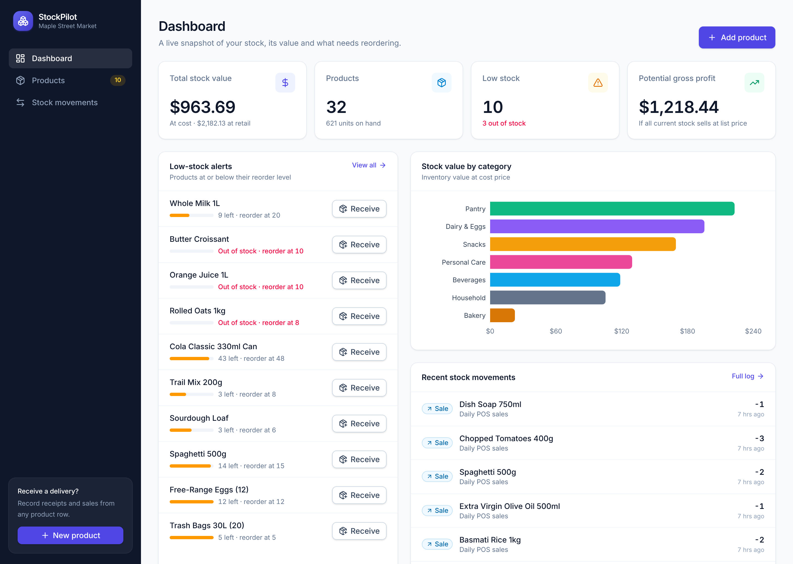
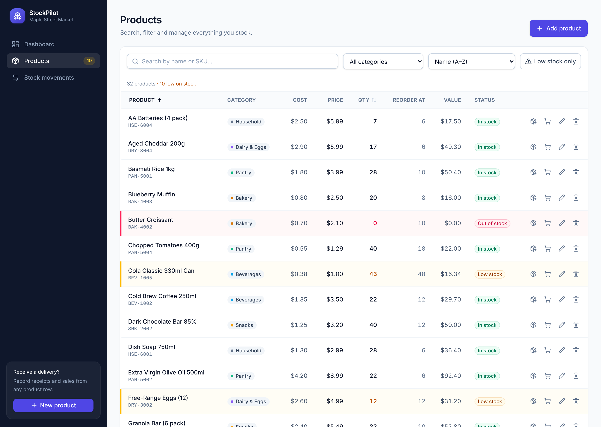
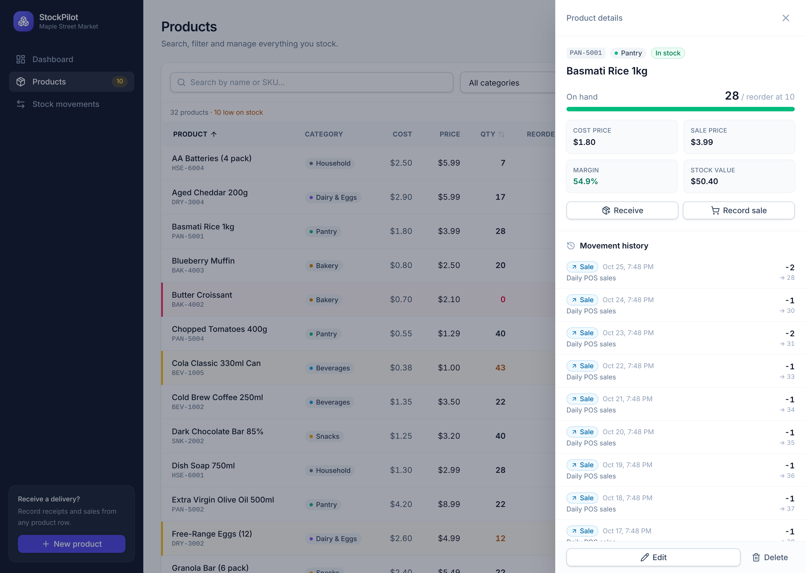
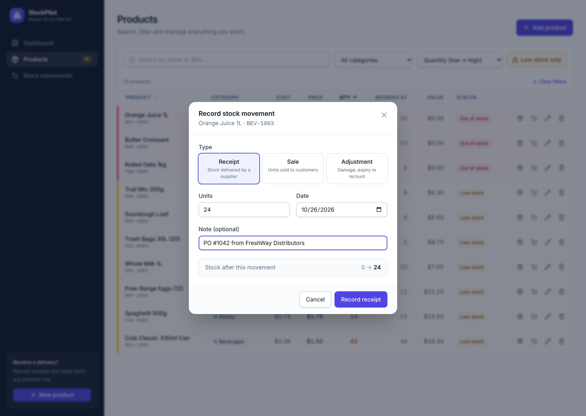
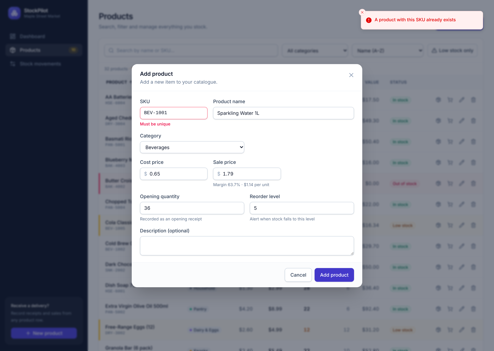
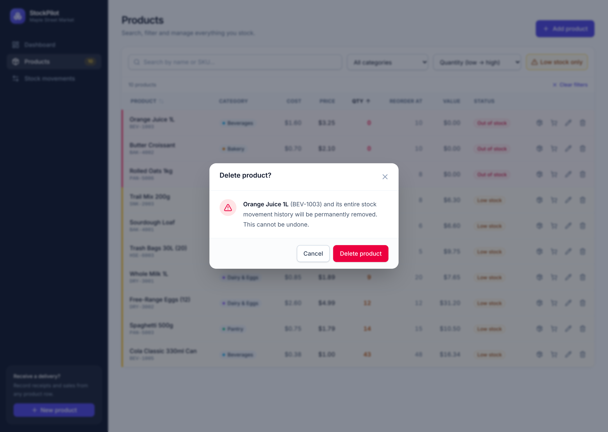
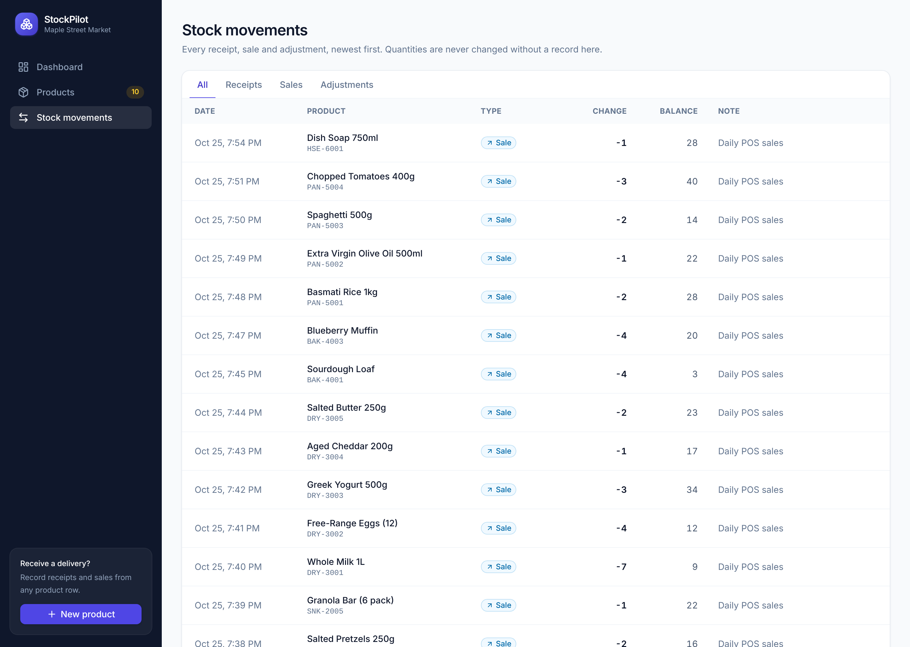
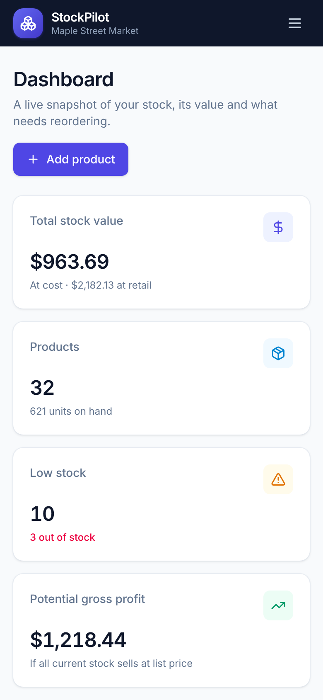
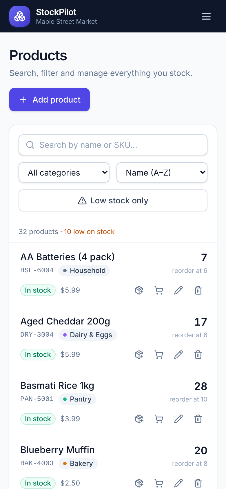

<div align="center">

# 📦 StockPilot

**A clean, fast inventory tracker for small shops.**
Know what you have, what it's worth, and what to reorder, at a glance.


<!-- After deploying, replace the link below with your Netlify URL -->

**[Live demo](#deploying-to-netlify)** · [Features](#features) · [Screenshots](#screenshots) · [Quick start](#quick-start) · [Architecture](#architecture) · [API](#api-reference)



</div>

---

## Features

**Products**

- Full CRUD for products with SKU, name, category, cost price, sale price, quantity and reorder level
- Confirmation dialog before deleting, spelling out exactly what will be removed
- Live margin preview while editing prices
- Click any product to open a details panel with its numbers and full movement history

**Stock movements**

- Every quantity change is recorded as a **receipt**, **sale** or **adjustment**, with date and note
- Quantity edits made through the product form are logged automatically as adjustments
- Back-dating supported (e.g. a delivery recorded the next morning)
- A "stock after this movement" preview so mistakes are caught before saving

**Low-stock alerts**

- Products at or below their reorder level are highlighted in amber (red when out of stock)
- Dedicated low-stock panel on the dashboard, sorted by urgency, with one-click "Receive"
- Low-stock count badge in the navigation

**Dashboard**

- Total stock value (at cost and at retail), number of products, low-stock count, potential gross profit
- Stock value by category chart
- Recent activity feed

**Search, filter and sort**

- Search by name or SKU (debounced), filter by category, "low stock only" toggle
- Sort by name or quantity, ascending or descending, from the dropdown or the column headers
- Filters live in the URL, so a filtered view can be bookmarked or shared

**Quality**

- Validation on both sides: instant form feedback in the UI, authoritative Zod validation in the API
- No negative quantities, unique SKUs (case-insensitive), consistent JSON error format
- Loading skeletons, empty states, error states with retry, toast notifications
- Fully responsive: sidebar on desktop, drawer navigation and card lists on mobile
- Keyboard and screen-reader friendly dialogs (focus management, Escape to close, labelled controls)
- 31 API tests covering CRUD, validation and the low-stock rule, run in CI on every push

## Screenshots

| Products (low stock highlighted)           | Product details & history                                |
| ------------------------------------------ | -------------------------------------------------------- |
|  |  |

| Recording a stock receipt                                | Validation: duplicate SKU                                  |
| -------------------------------------------------------- | ---------------------------------------------------------- |
|  |  |

| Delete confirmation                                         | Stock movement log                           |
| ----------------------------------------------------------- | -------------------------------------------- |
|  |  |

<p align="center">
  
  &nbsp;&nbsp;
  
</p>

## Quick start

**Requirements:** Node.js 20.12+ (22 recommended) and npm.

```bash
git clone https://github.com/dkorada/inventory-tracker.git
cd inventory-tracker
cp server/.env.example server/.env
npm run setup     # installs dependencies, creates the SQLite database and loads sample data
npm run dev       # API on http://localhost:4000, web app on http://localhost:5173
```

Open **http://localhost:5173**.

### Scripts

| Command             | What it does                                          |
| ------------------- | ----------------------------------------------------- |
| `npm run dev`       | Start API and web app together with hot reload        |
| `npm test`          | Run the API test suite (uses a separate `test.db`)    |
| `npm run typecheck` | Type-check server and client                          |
| `npm run build`     | Production build of both packages                     |
| `npm run db:seed`   | Replace all data with the sample data set             |
| `npm run db:reset`  | Recreate the database schema from scratch and seed it |
| `npm run format`    | Format the codebase with Prettier                     |

### Sample data

The seed creates **Maple Street Market**, a fictional neighbourhood grocery: 7 categories,
32 products and about 60 days of simulated history (daily sales, supplier deliveries when stock
hits the reorder level, occasional write-offs). A few items were deliberately "not reordered in
time" so the low-stock alerts have something to show. The simulation uses a seeded random
generator, so every run produces the same data. All names and figures are made up.

## Architecture

```
inventory-tracker/
├── client/                    React 19 + TypeScript + Vite + Tailwind CSS 4
│   └── src/
│       ├── pages/             Dashboard, Products, Stock movements
│       ├── components/        Layout, product form, movement dialog, details drawer
│       │   └── ui/            Button, Field, Modal, ConfirmDialog, Badge, states
│       ├── hooks/queries.ts   TanStack Query hooks (caching + invalidation)
│       └── lib/               Typed API client, formatting helpers, shared types
├── server/                    Node.js + Express 5 + Prisma + SQLite
│   ├── prisma/
│   │   ├── schema.prisma      Data model
│   │   └── seed.ts            Deterministic sample data
│   ├── src/
│   │   ├── routes/            products, movements, categories, dashboard
│   │   ├── services/          Inventory rules (stock changes, low-stock rule)
│   │   └── lib/               Prisma client, Zod schemas, error handling
│   └── tests/                 Vitest + Supertest API tests
├── netlify/functions/api.ts   Runs the Express API as a Netlify Function
├── netlify.toml               Netlify build and routing config
└── docs/                      Data model notes and screenshots
```

**Request flow:** the React app calls `/api/*` (proxied by Vite in development, rewritten to a
Netlify Function in production). Express routes validate input with Zod, business rules live in
`services/inventory.ts`, and Prisma talks to SQLite. Any stock change runs in a single
transaction that updates the product and appends to the movement ledger.

**Front-end state:** server state is managed by TanStack Query. After any change, the products,
movements and dashboard queries are invalidated so every screen stays in sync. All product
dialogs live in one `InventoryActionsProvider`, so the dashboard, product table and details
drawer share the same add / edit / delete / receive flows.

### Data model

Three tables: `Category`, `Product` and `StockMovement` (an append-only ledger).
Money is stored in integer cents, `quantity` is a running balance that only changes alongside a
movement row, and low stock is defined in one place as `quantity <= reorderLevel`.

➡️ See **[docs/DATA_MODEL.md](docs/DATA_MODEL.md)** for the ER diagram and the reasoning behind each decision.

## API reference

Base URL: `/api`. All responses are JSON. Successful responses use `{ "data": ... }`;
errors use `{ "error": { "code", "message", "details?" } }`.

| Method   | Endpoint                  | Description                                                                                                             |
| -------- | ------------------------- | ----------------------------------------------------------------------------------------------------------------------- |
| `GET`    | `/products`               | List products. Query: `search`, `categoryId`, `lowStock=true`, `sort=name\|quantity\|sku\|updatedAt`, `order=asc\|desc` |
| `GET`    | `/products/low-stock`     | Products at or below reorder level, most urgent first                                                                   |
| `GET`    | `/products/:id`           | One product with its 50 most recent movements                                                                           |
| `POST`   | `/products`               | Create a product (opening quantity is logged as a receipt)                                                              |
| `PUT`    | `/products/:id`           | Update any fields; a quantity change is logged as an adjustment (optional `note`)                                       |
| `DELETE` | `/products/:id`           | Delete a product and its history                                                                                        |
| `POST`   | `/products/:id/movements` | Record `{ type, quantity, note?, occurredAt? }`                                                                         |
| `GET`    | `/movements`              | Movement log. Query: `productId`, `type`, `limit` (max 500)                                                             |
| `GET`    | `/categories`             | Categories with product counts                                                                                          |
| `GET`    | `/dashboard`              | KPIs, value by category, low-stock list, recent movements                                                               |
| `GET`    | `/health`                 | Health check                                                                                                            |

<details>
<summary>Example: create a product</summary>

```http
POST /api/products
Content-Type: application/json

{
  "sku": "bev-1006",
  "name": "Iced Tea Peach 500ml",
  "categoryId": 1,
  "costPrice": 0.7,
  "salePrice": 1.79,
  "quantity": 48,
  "reorderLevel": 12
}
```

```json
{
  "data": {
    "id": 33,
    "sku": "BEV-1006",
    "name": "Iced Tea Peach 500ml",
    "costPrice": 0.7,
    "salePrice": 1.79,
    "quantity": 48,
    "reorderLevel": 12,
    "stockValue": 33.6,
    "isLowStock": false,
    "category": { "id": 1, "name": "Beverages", "color": "#0ea5e9" }
  }
}
```

</details>

<details>
<summary>Error codes</summary>

| Status | Code                 | When                                                                                                        |
| ------ | -------------------- | ----------------------------------------------------------------------------------------------------------- |
| 400    | `VALIDATION_ERROR`   | Missing or invalid fields (negative numbers, bad SKU format, unknown category). `details` lists each field. |
| 404    | `NOT_FOUND`          | Product or route does not exist                                                                             |
| 409    | `CONFLICT`           | SKU already in use                                                                                          |
| 422    | `INSUFFICIENT_STOCK` | A sale or adjustment would make stock negative                                                              |

</details>

## Testing

```bash
npm test
```

31 tests (Vitest + Supertest) run against a real, freshly created SQLite database:

- **CRUD:** create, list, get, update and delete products, including 404s
- **Validation:** negative quantity / reorder level / prices, missing fields, unknown category, duplicate SKU (case-insensitive), invalid movement payloads
- **Stock ledger:** receipts, sales and adjustments update the running balance; overselling is rejected and leaves no partial writes
- **Low-stock rule:** below, equal to and above the reorder level; the dedicated endpoint and `?lowStock=true` filter; products moving in and out of low stock as quantity or reorder level changes; dashboard KPIs

GitHub Actions runs formatting, type-checking, tests and a production build on every push and pull request.

## Deploying to Netlify

The repository is ready for Netlify: `netlify.toml` builds the React app as a static site and
deploys the Express API as a **Netlify Function**, with `/api/*` rewritten to it.

1. Sign in at [app.netlify.com](https://app.netlify.com) (a free account is enough).
2. **Add new site → Import an existing project → GitHub**, and pick `inventory-tracker`.
3. If Netlify asks which project to deploy in this monorepo, choose the **repository root**
   (leave _Base directory_ empty). Everything else is read from `netlify.toml`, so no settings or
   environment variables are needed.
4. Click **Deploy**. Your demo will be live at `https://<your-site>.netlify.app` in about two minutes.

**How data works on Netlify.** Serverless functions have no persistent disk. During the build a
seeded `demo.db` is created; each function instance copies it to `/tmp` and works on that copy.
Visitors can add, edit and delete freely, and the demo quietly returns to the sample data when
Netlify recycles the function. A banner in the app explains this to visitors. This is ideal for a
portfolio demo.

**For real, persistent use**, point Prisma at a hosted database instead: change the datasource
`provider` in `server/prisma/schema.prisma` to `postgresql` (for example a free
[Neon](https://neon.tech) or [Supabase](https://supabase.com) database), set `DATABASE_URL` in
Netlify's environment variables, and run `npx prisma db push` once. Alternatively, run the
Express server as-is on any Node host (Render, Railway, Fly.io, a VPS) and build the client with
`VITE_API_URL=https://your-api.example.com/api`.

## Tech choices

| Area          | Choice                                             | Why                                                                  |
| ------------- | -------------------------------------------------- | -------------------------------------------------------------------- |
| UI            | React 19, TypeScript, Tailwind CSS 4, lucide icons | Fast to build, consistent design tokens, small CSS output            |
| Data fetching | TanStack Query                                     | Caching, background refresh and simple invalidation after writes     |
| Charts        | Recharts                                           | Declarative, responsive charts in React                              |
| API           | Express 5                                          | Minimal and familiar; native async error handling                    |
| Validation    | Zod                                                | One schema gives parsing, coercion and readable error messages       |
| ORM / DB      | Prisma + SQLite                                    | Type-safe queries, zero-setup database file, easy move to PostgreSQL |
| Tests         | Vitest + Supertest                                 | Fast, TypeScript-native, tests the real HTTP layer                   |

## License

[MIT](LICENSE)
