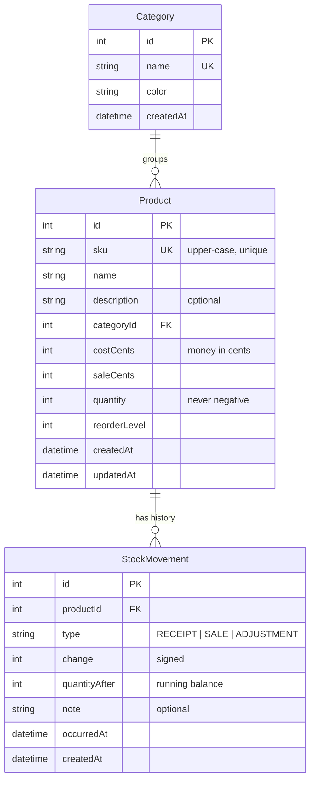

# Data model

StockPilot was designed data-model first. The goal: every number on screen can be explained, and
the database itself makes bad states hard to reach.

## Decisions

| Decision                                                                  | Why                                                                                                                                                                                                                                    |
| ------------------------------------------------------------------------- | -------------------------------------------------------------------------------------------------------------------------------------------------------------------------------------------------------------------------------------- |
| **Categories are a table**, not a free-text column                        | Consistent filtering and reporting, no "Snacks" vs "snacks" duplicates, and a colour per category for the UI. Deleting a category that still has products is blocked (`onDelete: Restrict`).                                           |
| **Money stored as integer cents** (`costCents`, `saleCents`)              | Floating-point maths drifts (`0.1 + 0.2 ≠ 0.3`). The API converts to/from decimal amounts at the boundary, so clients still send and receive `12.99`.                                                                                  |
| **SKU is unique and normalised to upper case**                            | `bev-001` and `BEV-001` are the same product to a human. Uniqueness is enforced twice: a friendly 409 check in the service layer and a `UNIQUE` index in the database as the last line of defence.                                     |
| **`quantity` is a cached running balance; `StockMovement` is the ledger** | Reads stay fast (no summing history to show a list), while every change is still auditable. The only code path that changes `quantity` is `applyStockChange()`, which updates the product and appends the movement in one transaction. |
| **Movements store a signed `change` and `quantityAfter`**                 | `change` makes totals trivial (`SUM(change)`); `quantityAfter` lets the history show the balance at each point without replaying the log.                                                                                              |
| **Editing quantity directly creates an `ADJUSTMENT`**                     | The product form allows fixing a count, but it never bypasses the ledger. Creating a product with stock records an "Opening stock" `RECEIPT`.                                                                                          |
| **`occurredAt` separate from `createdAt`**                                | Staff can back-date a delivery they forgot to record yesterday, while `createdAt` still shows when it was entered.                                                                                                                     |
| **Deleting a product cascades to its movements**                          | A deleted product's history has nothing to attach to. The UI makes this explicit in the confirmation dialog.                                                                                                                           |
| **SQLite has no enums**                                                   | `type` is a `String` validated by Zod (`RECEIPT`, `SALE`, `ADJUSTMENT`). Switching to PostgreSQL would let this become a native enum.                                                                                                  |

## Business rules

- **No negative stock.** Quantities and reorder levels must be whole numbers `>= 0`. A sale or
  negative adjustment that would take stock below zero is rejected with `422 INSUFFICIENT_STOCK`,
  and nothing is written.
- **Low stock** means `quantity <= reorderLevel`. The rule lives in one place
  (`isLowStock()` / `lowStockWhere()` in `server/src/services/inventory.ts`) and is evaluated in SQL as a
  column-to-column comparison, so filtering stays in the database.
- **Stock value** is `quantity × cost price`, summed across products. Retail value and potential
  gross profit use the sale price.

## Indexes

- `Product.sku` unique, `Product.categoryId`, `Product.name` for search and sort.
- `StockMovement(productId, occurredAt)` for a product's history; `StockMovement(occurredAt)` for the global log.
